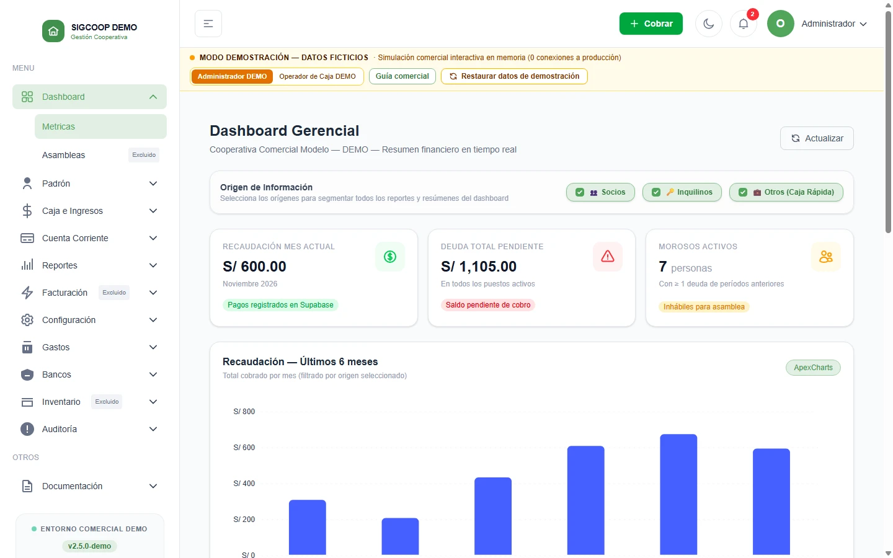

<picture>
  <source media="(prefers-color-scheme: dark)" srcset="assets/op-banner-dark.svg">
  
</picture>

# Oscar Martin Paredes Morales

**Full-Stack & Backend Developer** · Business applications

[Portfolio in English](https://portafolio-plum-xi-81.vercel.app/?lang=en) · [Portafolio en español](https://portafolio-plum-xi-81.vercel.app/) · [Resumen en español](#en-español)

## About me

I turn business requirements into interfaces, SQL rules, and tests. My background in commercial operations helps me understand how teams collect payments, track service orders, and manage inventory.

## Technology stack

`Angular` `TypeScript` `PostgreSQL` `Supabase`

- **Frontend** · React and Next.js for my bilingual portfolio.
- **Backend & data** · SQL, relational modeling, transactions, row-level security, and Supabase RPC.
- **Deployment** · Cloudflare Pages and Vercel.
- **Python & applied AI** · Data processing, visualization, and academic work on computer vision.

## Featured projects

### SIGCOOP · Cooperative market ERP

**In production** · Angular, TypeScript, PostgreSQL, Supabase, Cloudflare Pages

Cashiers record payments and accounting staff reconcile receipts. PostgreSQL processes financial writes in transactions and separates new receipts from previously paid credit in the accounting report.

[SIGCOOP repository](https://github.com/omparedes/SistemaCooperativa) · [SIGCOOP case study](https://portafolio-plum-xi-81.vercel.app/projects/sigcoop?lang=en) · [Try the SIGCOOP demo with synthetic data](https://sigcoop-demo.pages.dev/)

### PCMYM · Repair-shop service orders

**MVP in use in my workshop** · Angular, TypeScript, PostgreSQL, Supabase

Tracks repairs from intake to handover. PostgreSQL validates order transitions and prevents parts allocations from taking stock below zero.

[PCMYM repository](https://github.com/omparedes/PCMYM) · [PCMYM case study](https://portafolio-plum-xi-81.vercel.app/projects/pcmym?lang=en)

### SmartParking · Parking occupancy

**Academic thesis project** · Angular, Supabase Realtime, computer vision

Shows operators which spaces are free. Angular subscribes to occupancy changes and alerts. The thesis documents how an external YOLO detector would report events to Supabase.

[SmartParking repository (ParkingApp2)](https://github.com/omparedes/ParkingApp2) · [SmartParking case study](https://portafolio-plum-xi-81.vercel.app/projects/smartparking?lang=en)

### MelodyCosmetics · Retail sales and inventory

**Internal application in development** · Angular, TypeScript, PostgreSQL, Supabase

Lets staff find products and record sales on a phone. PostgreSQL locks stock balances and records each sale and its inventory movements in the same transaction.

[MelodyCosmetics repository](https://github.com/omparedes/MelodyCosmetics) · [MelodyCosmetics case study](https://portafolio-plum-xi-81.vercel.app/projects/melodycosmetics?lang=en)

## Engineering practice

I clarify requirements, document architecture decisions, and verify business rules with Vitest and SQL checks. I use Git to track changes and support debugging and deployment. [AgentEngineeringHub](https://github.com/omparedes/AgentEngineeringHub) documents how I select agent tools, review permissions, and verify changes.

## Education and continuous learning

I’m in the final semesters of Systems Engineering at Universidad Peruana de Ciencias Aplicadas (UPC). My continuing education includes Python for data processing and SQL for analysis.

## Contact

[Portfolio in English](https://portafolio-plum-xi-81.vercel.app/?lang=en) · [Portafolio en español](https://portafolio-plum-xi-81.vercel.app/) · [Contact via my portfolio](https://portafolio-plum-xi-81.vercel.app/contact?lang=en)

## En español

Desarrollo aplicaciones empresariales con Angular, TypeScript, PostgreSQL y Supabase. Mi experiencia en gestión comercial y operaciones desde 2011 me ayuda a traducir procesos de negocio en interfaces, reglas SQL y pruebas. Curso los últimos ciclos de Ingeniería de Sistemas en la UPC y me interesa la IA aplicada. [Ver los estudios de caso](https://portafolio-plum-xi-81.vercel.app/projects) · [Contacto](https://portafolio-plum-xi-81.vercel.app/contact)
